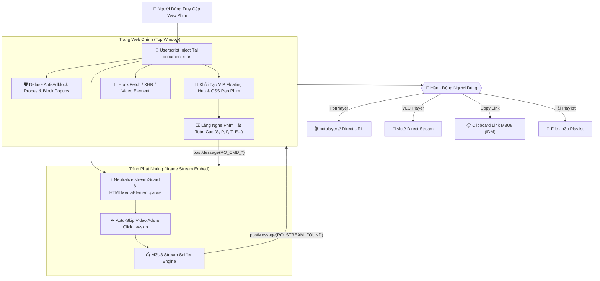

# 🎬 Bypass WebFilm — Cinema Pro Suite (Ultimate Edition v5.0)

<p align="center">
  
  
  
  
  
</p>

<p align="center">
  <strong>🔥 Vũ khí tối thượng mở khóa trải nghiệm xem phim đỉnh cao: Chặn 100% quảng cáo & popup cá cược, diệt sạch Anti-Adblock & Stream Guard, bắt trọn luồng M3U8 phát PotPlayer/VLC/IINA 1-Click, tua Intro 85s, Anime OLED HDR, Theater Mode & Mở khóa VIP vĩnh viễn trên hơn 52+ website xem phim & anime hàng đầu Việt Nam!</strong>
</p>

---

## ⚡ Tổng Quan & Triết Lý Thiết Kế (Apex Engineering)

> **"Xem phim là để thưởng thức nghệ thuật, không phải để xem quảng cáo lừa đảo, cờ bạc hay chờ đợi 60 giây pre-roll vô nghĩa."**

Hầu hết các trang web chiếu phim trực tuyến hiện nay đều cài cắm hàng chục tầng mã độc theo dõi, popup bẫy click mở tab cá độ bóng đá, cơ chế **Stream Guard** ép người dùng tắt trình chặn quảng cáo, cùng trình phát nhúng bị giới hạn chất lượng và giấu luồng video.

**Cinema Pro Suite v5.0** được thiết kế từ nguyên lý **Zero-Compromise Security & Performance**:
1. **Patchless Anti-Adblock Defusal**: Vô hiệu hóa toàn bộ cơ chế phát hiện Adblock (`probe_until`, `adblock_detected`, `window.streamGuard`) tại tầng nguyên tử của DOM mà không làm gián đoạn luồng phát video.
2. **Iframe Remote Control Bridge**: Cầu nối `postMessage` hai chiều xuyên qua sandbox iframe của các máy chủ streaming quốc tế (StreamTape, DoodStream, Turbovid, NguonC, PhimAPI, Vidsrc, Streamsilk, Streamruby, v.v.).
3. **M3U8 Sniffer & Direct Desktop Playback**: Bắt trọn link luồng m3u8 sạch và kích hoạt ngay **PotPlayer / VLC / IINA / MPV** với độ trễ 0s và chất lượng hình ảnh gốc tối đa.
4. **Glassmorphism Floating Control Hub**: Bảng điều khiển nổi sang trọng, hiện đại với hiệu ứng làm mờ nền kính, tích hợp đầy đủ 13 phím chức năng thần thánh.

---

## 📁 Cấu Trúc Dự Án (Clean Open-Source Architecture)

Dự án được tái cấu trúc theo tiêu chuẩn mã nguồn mở quốc tế cực kỳ gọn gàng và tinh tế:

```text
bypass-webfilm/
├── scripts/                # 📂 Toàn bộ 52+ Userscripts cho từng web & Master All-In-One Suite
│   ├── cinema-pro-all.user.js   # 👑 Bản Master Gộp (All-In-One: 1 script chạy toàn bộ web)
│   ├── rophim.user.js           # 🎬 Rổ Phim VIP 2099 + Vô hạn Coin
│   ├── motchill.user.js         # 🍿 Motchill VIP & Stream Guard Killer
│   ├── animevietsub.user.js     # 🌸 AnimeVietsub OLED HDR & Skip Intro
│   ├── phimmoi.user.js          # 🎥 PhimMoi & PhimMoiChill
│   ├── hoathinh3d.user.js       # 🐉 Hoạt Hình 3D Trung Quốc
│   ├── phimchill.user.js        # 🌴 PhimChill Pro
│   └── ...                      # (54 files userscript drop-in production)
├── src/                    # 📂 Lõi JavaScript thuần (Engine Core)
│   └── core.js                  # Lõi thực thi ES2022 không kèm header (dành cho console/nhúng)
├── build_all_scripts.js    # 🛠️ Trình tạo mã & build tự động 54 Userscripts song song
├── run_audit.js            # 🧪 Bộ kiểm thử tự động toàn diện Sandbox VM (750+ assertions)
└── README.md               # 📖 Tài liệu hướng dẫn & Bảng link cài đặt 1-Click
```

---

## 📊 Bảng So Sánh Tính Năng (Feature Matrix)

| Tiêu Chí & Trải Nghiệm | ❌ Khi Chưa Cài Script | 👑 Cinema Pro Suite v5.0 |
| :--- | :--- | :--- |
| **Quảng cáo đầu phim (Pre-roll Ads)** | Ép xem 15s - 60s, không thể bỏ qua | ⚡ **Tua sạch 0s ngay lập tức**, tự động click nút Skip |
| **Banner, Catfish, Popup cá độ** | Nhấp nháy 4 góc, che phụ đề, bẫy click | 🛡️ **Diệt sạch 100%**, triệt tiêu toàn bộ mã bẫy popup |
| **Stream Guard / Anti-Adblock** | Hiện bảng cảnh báo, bắt tắt Adblock mới cho xem | 🔓 **Defuse ngầm tự động**, player phát mượt mà không bao giờ bị chặn |
| **Xem trên PotPlayer / VLC / IINA** | Không hỗ trợ, phải inspect tìm link mệt mỏi | 🚀 **1-Click khởi chạy ứng dụng ngoài**, tải playlist `.m3u` tức thì |
| **Bắt link tải video M3U8** | Bị mã hóa base64, token hóa, giấu sâu trong iframe | 📋 **Tự động bắt link vào Clipboard**, tương thích IDM / FDM / XDM |
| **Bỏ qua Intro / Nhạc mở đầu** | Kéo chuột dò mẫm, dễ bị tua lố | ⏭️ **Phím `S` hoặc `I`**: Nhảy chính xác +85s intro |
| **Tua nhanh / Tua lùi chính xác** | Khựng giật, player web tải lại chậm | ⏩ **Phím Mũi tên**: `±5s`, `Shift+Mũi tên`: `±10s`, `Ctrl+Mũi tên`: `±30s` |
| **Màu sắc & Độ tương phản Anime** | Nhạt màu, thiếu chiều sâu trên màn hình OLED | ✨ **Phím `E` (Anime OLED HDR)**: Tăng bão hòa màu, tương phản rực rỡ |
| **Không gian rạp phim (Theater Mode)** | Web sáng chói, giao diện xung quanh rối mắt | 🎭 **Phím `T` (Cinema Mode)**: Làm tối toàn bộ web, nổi bật khung video |
| **Xem đa nhiệm (Picture-in-Picture)** | Thường bị khóa bởi trình phát của web | 🖼️ **Phím `P` (PiP Mode)**: Đưa video nổi góc màn hình để vừa làm việc vừa xem |
| **Điều khiển tốc độ linh hoạt** | Bị khóa ở 1x hoặc chỉ lên tối đa 2x | ⚡ **Phím `[` & `]`**: Tùy chỉnh tốc độ từ `0.5x` đến `3.0x` mượt mà |
| **Đặc quyền VIP Rổ Phim (Rophim)** | Phải nạp tiền thật mua VIP & Coin | 💰 **Mở khóa VIP 2099 + 999,999,999 Coin tự động** |

---

## 🏗️ Sơ Đồ Kiến Trúc Luồng Hoạt Động (Architecture Flowchart)



---

## 🚀 Hướng Dẫn Cài Đặt Siêu Tốc (1-Click Install)

### Bước 1: Cài đặt tiện ích UserScript Manager trên trình duyệt của bạn
Cài đặt một trong các tiện ích mở rộng miễn phí sau (Khuyên dùng **Tampermonkey** hoặc **Violentmonkey**):
- 🌐 **Tampermonkey**: [Chrome Web Store](https://chrome.google.com/webstore/detail/tampermonkey/dhdgffkkebhmkfjojejmpbldmpobfkfo) | [Firefox Add-ons](https://addons.mozilla.org/en-US/firefox/addon/tampermonkey/) | [Microsoft Edge](https://microsoftedge.microsoft.com/addons/detail/tampermonkey/iikmkjmpaadaobahmlepeloendndfphd)
- 🐒 **Violentmonkey**: [Trang chủ Violentmonkey](https://violentmonkey.github.io/get-it/)
- 📱 **Trên điện thoại Android**: Sử dụng trình duyệt **Kiwi Browser** hoặc **Firefox Mobile** và cài Tampermonkey như trên PC.
- 🍏 **Trên iPhone / iPad / Mac Safari**: Cài đặt tiện ích **Userscripts** hoặc **Stay** từ App Store.

---

### Bước 2: Cài đặt Script VIP (Chọn Bản Phù Hợp)

#### 👑 1. KHUYÊN DÙNG: BẢN MASTER TẤT CẢ TRONG MỘT (ALL-IN-ONE)
Chỉ cần bấm cài đặt **DUY NHẤT 1 LẦN**, script sẽ tự động nhận diện và kích hoạt full tính năng VIP trên **TOÀN BỘ 52+ WEBSITE PHIM BÊN DƯỚI**:

👉 **[BẤM VÀO ĐÂY ĐỂ CÀI ĐẶT BẢN ALL-IN-ONE](https://raw.githubusercontent.com/ekaznyra/bypass-webfilm/main/scripts/cinema-pro-all.user.js)**  
*(Tự động cập nhật phiên bản mới nhất từ GitHub khi có web đổi tên miền)*

---

#### 🎬 2. BẢN DÀNH RIÊNG CHO PHIM CHIẾU RẠP, PHIM LẺ & PHIM BỘ (25 Web)

| Trang Web | Trạng Thái | Link Cài Đặt 1-Click | Tên Miền Hỗ Trợ |
| :--- | :---: | :---: | :--- |
| 🎬 **Rophim** | 🟢 Sẵn sàng | 👉 **[CÀI ĐẶT ROPHIM](https://raw.githubusercontent.com/ekaznyra/bypass-webfilm/main/scripts/rophim.user.js)** | `rophim1.vip`, `www.rophim1.vip`, `rophim1.cc`... |
| 🎬 **Motchill** | 🟢 Sẵn sàng | 👉 **[CÀI ĐẶT MOTCHILL](https://raw.githubusercontent.com/ekaznyra/bypass-webfilm/main/scripts/motchill.user.js)** | `phimmotchill.online`, `motchill.online`, `motchilltv.org`... |
| 🎬 **NangCuc TV** | 🟢 Sẵn sàng | 👉 **[CÀI ĐẶT NANGCUC TV](https://raw.githubusercontent.com/ekaznyra/bypass-webfilm/main/scripts/nangcuc.user.js)** | `nangcuc.tv`, `nangcuc.net`, `nangcuc.cc`... |
| 🎬 **SubNhanh** | 🟢 Sẵn sàng | 👉 **[CÀI ĐẶT SUBNHANH](https://raw.githubusercontent.com/ekaznyra/bypass-webfilm/main/scripts/subnhanh.user.js)** | `subnhanh.org`, `subnhanh.com`, `subnhanh.vip`... |
| 🎬 **PhimMoi & PhimMoiChill** | 🟢 Sẵn sàng | 👉 **[CÀI ĐẶT PHIMMOI & PHIMMOICHILL](https://raw.githubusercontent.com/ekaznyra/bypass-webfilm/main/scripts/phimmoi.user.js)** | `phimmoiyyy.net`, `phimmoichill.net`, `phimmoichill.tv`... |
| 🎬 **DongPhim** | 🟢 Sẵn sàng | 👉 **[CÀI ĐẶT DONGPHIM](https://raw.githubusercontent.com/ekaznyra/bypass-webfilm/main/scripts/dongphim.user.js)** | `dongphim.net`, `dongphym.net`, `dongphim.cc`... |
| 🎬 **TVHay Thuyết Minh** | 🟢 Sẵn sàng | 👉 **[CÀI ĐẶT TVHAY THUYẾT MINH](https://raw.githubusercontent.com/ekaznyra/bypass-webfilm/main/scripts/tvhay.user.js)** | `tvhay.site`, `tvhay.org`, `tvhay.co`... |
| 🎬 **BiluTV** | 🟢 Sẵn sàng | 👉 **[CÀI ĐẶT BILUTV](https://raw.githubusercontent.com/ekaznyra/bypass-webfilm/main/scripts/bilutv.user.js)** | `bilutv.live`, `bilutva.com`, `bilutv.link`... |
| 🎬 **Phim1080** | 🟢 Sẵn sàng | 👉 **[CÀI ĐẶT PHIM1080](https://raw.githubusercontent.com/ekaznyra/bypass-webfilm/main/scripts/phim1080.user.js)** | `phim1080z.org`, `phim1080.net`, `phim1080.me`... |
| 🎬 **XemPhim** | 🟢 Sẵn sàng | 👉 **[CÀI ĐẶT XEMPHIM](https://raw.githubusercontent.com/ekaznyra/bypass-webfilm/main/scripts/xemphim.user.js)** | `xemphim.tv`, `xemphim.in`, `xemphim.club`... |
| 🎬 **Phim247** | 🟢 Sẵn sàng | 👉 **[CÀI ĐẶT PHIM247](https://raw.githubusercontent.com/ekaznyra/bypass-webfilm/main/scripts/phim247.user.js)** | `phim247.tv`, `phim247.vip` |
| 🎬 **PhimHD** | 🟢 Sẵn sàng | 👉 **[CÀI ĐẶT PHIMHD](https://raw.githubusercontent.com/ekaznyra/bypass-webfilm/main/scripts/phimhd.user.js)** | `phimhd.com`, `phimhd.tv` |
| 🎬 **PhimBatHu** | 🟢 Sẵn sàng | 👉 **[CÀI ĐẶT PHIMBATHU](https://raw.githubusercontent.com/ekaznyra/bypass-webfilm/main/scripts/phimbathu.user.js)** | `phimbathu.com`, `phimbathu.net` |
| 🎬 **PhimVang** | 🟢 Sẵn sàng | 👉 **[CÀI ĐẶT PHIMVANG](https://raw.githubusercontent.com/ekaznyra/bypass-webfilm/main/scripts/phimvang.user.js)** | `phimvang.com`, `phimvang.tv` |
| 🎬 **PhimChill** | 🟢 Sẵn sàng | 👉 **[CÀI ĐẶT PHIMCHILL](https://raw.githubusercontent.com/ekaznyra/bypass-webfilm/main/scripts/phimchill.user.js)** | `phimchill.net`, `phimchill.tv`, `phimchill.org`... |
| 🎬 **LuotPhim** | 🟢 Sẵn sàng | 👉 **[CÀI ĐẶT LUOTPHIM](https://raw.githubusercontent.com/ekaznyra/bypass-webfilm/main/scripts/luotphim.user.js)** | `luotphim.net`, `luotphim.tv`, `luotphim.cc`... |
| 🎬 **PhimNhanh** | 🟢 Sẵn sàng | 👉 **[CÀI ĐẶT PHIMNHANH](https://raw.githubusercontent.com/ekaznyra/bypass-webfilm/main/scripts/phimnhanh.user.js)** | `phimnhanh.tv`, `phimnhanh.net`, `phimnhanh.io`... |
| 🎬 **HayGhe** | 🟢 Sẵn sàng | 👉 **[CÀI ĐẶT HAYGHE](https://raw.githubusercontent.com/ekaznyra/bypass-webfilm/main/scripts/hayghe.user.js)** | `hayghe.tv`, `hayghe.net`, `hayghe.org`... |
| 🎬 **PhimKo** | 🟢 Sẵn sàng | 👉 **[CÀI ĐẶT PHIMKO](https://raw.githubusercontent.com/ekaznyra/bypass-webfilm/main/scripts/phimko.user.js)** | `phimko.net`, `phimko.com`, `phimko.tv`... |
| 🎬 **CuongPhim** | 🟢 Sẵn sàng | 👉 **[CÀI ĐẶT CUONGPHIM](https://raw.githubusercontent.com/ekaznyra/bypass-webfilm/main/scripts/cuongphim.user.js)** | `cuongphim.com`, `cuongphim.net`, `cuongphim.tv`... |
| 🎬 **BongNgo TV** | 🟢 Sẵn sàng | 👉 **[CÀI ĐẶT BONGNGO TV](https://raw.githubusercontent.com/ekaznyra/bypass-webfilm/main/scripts/bongngo.user.js)** | `bongngo.tv`, `bongngo.net`, `bongngotv.com`... |
| 🎬 **XomPhim** | 🟢 Sẵn sàng | 👉 **[CÀI ĐẶT XOMPHIM](https://raw.githubusercontent.com/ekaznyra/bypass-webfilm/main/scripts/xomphim.user.js)** | `xomphim.tv`, `xomphim.net`, `xomphim.com`... |
| 🎬 **PhimBom** | 🟢 Sẵn sàng | 👉 **[CÀI ĐẶT PHIMBOM](https://raw.githubusercontent.com/ekaznyra/bypass-webfilm/main/scripts/phimbom.user.js)** | `phimbom.tv`, `phimbom.net`, `phimbom.org`... |
| 🎬 **TVZing & ZingTV** | 🟢 Sẵn sàng | 👉 **[CÀI ĐẶT TVZING & ZINGTV](https://raw.githubusercontent.com/ekaznyra/bypass-webfilm/main/scripts/tvzing.user.js)** | `tvzing.net`, `tvzing.tv`, `zingtv.com`... |
| 🎬 **PhimChieuRap** | 🟢 Sẵn sàng | 👉 **[CÀI ĐẶT PHIMCHIEURAP](https://raw.githubusercontent.com/ekaznyra/bypass-webfilm/main/scripts/phimchieurap.user.js)** | `phimchieurap.tv`, `phimchieurap.net`, `phimchieurap.org`... |

---

#### 🌸 3. BẢN DÀNH RIÊNG CHO ANIME VIETSUB & HOẠT HÌNH 3D TRUNG QUỐC (13 Web)

| Trang Web | Trạng Thái | Link Cài Đặt 1-Click | Tên Miền Hỗ Trợ |
| :--- | :---: | :---: | :--- |
| 🎬 **AnimeVietsub** | 🟢 Sẵn sàng | 👉 **[CÀI ĐẶT ANIMEVIETSUB](https://raw.githubusercontent.com/ekaznyra/bypass-webfilm/main/scripts/animevietsub.user.js)** | `animevietsub.moe`, `animevietsub.link`, `animevietsub.global`... |
| 🎬 **HoatHinh3D** | 🟢 Sẵn sàng | 👉 **[CÀI ĐẶT HOATHINH3D](https://raw.githubusercontent.com/ekaznyra/bypass-webfilm/main/scripts/hoathinh3d.user.js)** | `hoathinh3d.biz`, `hoathinh3d.com`, `hoathinh3d.site`... |
| 🎬 **AnimeHay** | 🟢 Sẵn sàng | 👉 **[CÀI ĐẶT ANIMEHAY](https://raw.githubusercontent.com/ekaznyra/bypass-webfilm/main/scripts/animehay.user.js)** | `animehay.tv`, `animehay.live`, `animehay.site`... |
| 🎬 **Anime47** | 🟢 Sẵn sàng | 👉 **[CÀI ĐẶT ANIME47](https://raw.githubusercontent.com/ekaznyra/bypass-webfilm/main/scripts/anime47.user.js)** | `anime47.net`, `anime47.com`, `anime47.tv`... |
| 🎬 **DongHuaTV** | 🟢 Sẵn sàng | 👉 **[CÀI ĐẶT DONGHUATV](https://raw.githubusercontent.com/ekaznyra/bypass-webfilm/main/scripts/donghuatv.user.js)** | `donghuatv.com`, `donghua.tv`, `donghuatv.net`... |
| 🎬 **VuiGhe** | 🟢 Sẵn sàng | 👉 **[CÀI ĐẶT VUIGHE](https://raw.githubusercontent.com/ekaznyra/bypass-webfilm/main/scripts/vuighe.user.js)** | `vuighe.net`, `vuighe3.com`, `vuighe.com` |
| 🎬 **AnimeTVN** | 🟢 Sẵn sàng | 👉 **[CÀI ĐẶT ANIMETVN](https://raw.githubusercontent.com/ekaznyra/bypass-webfilm/main/scripts/animetvn.user.js)** | `animetvn.com`, `animetvn.tv`, `animetvn.net` |
| 🎬 **HoatHinh KungFu** | 🟢 Sẵn sàng | 👉 **[CÀI ĐẶT HOATHINH KUNGFU](https://raw.githubusercontent.com/ekaznyra/bypass-webfilm/main/scripts/hhkungfu.user.js)** | `hhkungfu.tv`, `hhkungfu.com`, `hhkungfu.net` |
| 🎬 **HoatHinh Panda** | 🟢 Sẵn sàng | 👉 **[CÀI ĐẶT HOATHINH PANDA](https://raw.githubusercontent.com/ekaznyra/bypass-webfilm/main/scripts/hhpanda.user.js)** | `hhpanda.com`, `hhpanda.tv` |
| 🎬 **KhoAnime** | 🟢 Sẵn sàng | 👉 **[CÀI ĐẶT KHOANIME](https://raw.githubusercontent.com/ekaznyra/bypass-webfilm/main/scripts/khoanime.user.js)** | `khoanime.tv`, `khoanime.net`, `khoanime.com`... |
| 🎬 **AnimeMoi** | 🟢 Sẵn sàng | 👉 **[CÀI ĐẶT ANIMEMOI](https://raw.githubusercontent.com/ekaznyra/bypass-webfilm/main/scripts/animemoi.user.js)** | `animemoi.com`, `animemoi.net`, `animemoi.tv`... |
| 🎬 **AnimeChill** | 🟢 Sẵn sàng | 👉 **[CÀI ĐẶT ANIMECHILL](https://raw.githubusercontent.com/ekaznyra/bypass-webfilm/main/scripts/animechill.user.js)** | `animechill.net`, `animechill.tv`, `animechill.org`... |
| 🎬 **VietAnime** | 🟢 Sẵn sàng | 👉 **[CÀI ĐẶT VIETANIME](https://raw.githubusercontent.com/ekaznyra/bypass-webfilm/main/scripts/vietanime.user.js)** | `vietanime.net`, `vietanime.tv`, `vietanime.org`... |

---

#### 📺 4. BẢN DÀNH CHO KHO NGUỒN MỞ, PHIM THUYẾT MINH & TỔNG HỢP (14 Web)

| Trang Web | Trạng Thái | Link Cài Đặt 1-Click | Tên Miền Hỗ Trợ |
| :--- | :---: | :---: | :--- |
| 🎬 **OPhim & KKPhim** | 🟢 Sẵn sàng | 👉 **[CÀI ĐẶT OPHIM & KKPHIM](https://raw.githubusercontent.com/ekaznyra/bypass-webfilm/main/scripts/ophim.user.js)** | `ophim.cc`, `ophim.live`, `kkphim.com`... |
| 🎬 **BiPhim & PhimChill** | 🟢 Sẵn sàng | 👉 **[CÀI ĐẶT BIPHIM & PHIMCHILL](https://raw.githubusercontent.com/ekaznyra/bypass-webfilm/main/scripts/biphim.user.js)** | `biphim.net`, `biphim.co`, `phimchill.tv`... |
| 🎬 **MotPhim** | 🟢 Sẵn sàng | 👉 **[CÀI ĐẶT MOTPHIM](https://raw.githubusercontent.com/ekaznyra/bypass-webfilm/main/scripts/motphim.user.js)** | `motphim.to`, `motphimtv.me`, `motphimtv.top`... |
| 🎬 **MePhim** | 🟢 Sẵn sàng | 👉 **[CÀI ĐẶT MEPHIM](https://raw.githubusercontent.com/ekaznyra/bypass-webfilm/main/scripts/mephim.user.js)** | `mephimtv.com`, `mephim.net`, `mephim.tv` |
| 🎬 **GhienPhim** | 🟢 Sẵn sàng | 👉 **[CÀI ĐẶT GHIENPHIM](https://raw.githubusercontent.com/ekaznyra/bypass-webfilm/main/scripts/ghienphim.user.js)** | `ghienphim.net`, `ghienphim.tv`, `ghienphim.org` |
| 🎬 **FullPhim** | 🟢 Sẵn sàng | 👉 **[CÀI ĐẶT FULLPHIM](https://raw.githubusercontent.com/ekaznyra/bypass-webfilm/main/scripts/fullphim.user.js)** | `fullphim.net`, `fullphim.tv`, `fullphim.org` |
| 🎬 **PhimHay** | 🟢 Sẵn sàng | 👉 **[CÀI ĐẶT PHIMHAY](https://raw.githubusercontent.com/ekaznyra/bypass-webfilm/main/scripts/phimhay.user.js)** | `phimhay.co`, `phimhay.net`, `phimhay.tv` |
| 🎬 **VietSubTV** | 🟢 Sẵn sàng | 👉 **[CÀI ĐẶT VIETSUBTV](https://raw.githubusercontent.com/ekaznyra/bypass-webfilm/main/scripts/vietsubtv.user.js)** | `vietsubtv.org`, `vietsubtv.com`, `vietsubtv.net` |
| 🎬 **BanhTV** | 🟢 Sẵn sàng | 👉 **[CÀI ĐẶT BANHTV](https://raw.githubusercontent.com/ekaznyra/bypass-webfilm/main/scripts/banhtv.user.js)** | `banhtv.net`, `banhtv.cc` |
| 🎬 **HDOnline** | 🟢 Sẵn sàng | 👉 **[CÀI ĐẶT HDONLINE](https://raw.githubusercontent.com/ekaznyra/bypass-webfilm/main/scripts/hdonline.user.js)** | `hdonline.co`, `hdonline.tv` |
| 🎬 **ChillHay** | 🟢 Sẵn sàng | 👉 **[CÀI ĐẶT CHILLHAY](https://raw.githubusercontent.com/ekaznyra/bypass-webfilm/main/scripts/chillhay.user.js)** | `chillhay.com`, `chillhay.tv` |
| 🎬 **XemPhimPlus** | 🟢 Sẵn sàng | 👉 **[CÀI ĐẶT XEMPHIMPLUS](https://raw.githubusercontent.com/ekaznyra/bypass-webfilm/main/scripts/xemphimplus.user.js)** | `xemphimplus.net` |
| 🎬 **TopSub** | 🟢 Sẵn sàng | 👉 **[CÀI ĐẶT TOPSUB](https://raw.githubusercontent.com/ekaznyra/bypass-webfilm/main/scripts/topsub.user.js)** | `topsub.org`, `topsub.net`, `topsub.tv`... |
| 🎬 **SSPhim** | 🟢 Sẵn sàng | 👉 **[CÀI ĐẶT SSPHIM](https://raw.githubusercontent.com/ekaznyra/bypass-webfilm/main/scripts/ssphim.user.js)** | `ssphim.net`, `ssphim.tv`, `ssphim.org`... |

---

## ⌨️ Cẩm Nang Phím Tắt Thần Thánh (Pro Hotkeys Cheat Sheet)

Các phím tắt hoạt động đồng nhất trên mọi trình phát và mọi trang web (tự động khóa khi người dùng gõ vào ô tìm kiếm hoặc comment):

| Phím Tắt | Chức Năng Chi Tiết | Lợi Ích & Mô Tả |
| :---: | :--- | :--- |
| **`S`** hoặc **`I`** | **Bỏ qua bài hát Intro (+85 giây)** | Nhảy vọt qua đoạn mở đầu bài hát anime/phim bộ ngay lập tức |
| **`←`** / **`→`** | **Tua lùi / Tua tới 5 giây** | Tua nhanh linh hoạt từng chi tiết nhỏ |
| **`Shift + ←`** / **`Shift + →`** | **Tua lùi / Tua tới 10 giây** | Tua đoạn trung bình |
| **`Ctrl + ←`** / **`Ctrl + →`** | **Tua lùi / Tua tới 30 giây** | Tua lướt nhanh cảnh hội thoại dài |
| **`↑`** / **`↓`** | **Tăng / Giảm âm lượng 5%** | Tinh chỉnh âm thanh chuẩn xác |
| **`F`** | **Toàn màn hình (Fullscreen Toggle)** | Phóng to tràn viền loại bỏ thanh điều hướng |
| **`P`** | **Picture-in-Picture (Cửa sổ nổi)** | Đưa video nổi lên góc màn hình để vừa làm việc vừa xem |
| **`T`** | **Chế độ Rạp phim (Cinema Theater Mode)** | Làm mờ tối 90% giao diện web xung quanh |
| **`E`** | **Bật / Tắt bộ lọc Anime OLED HDR** | Tăng độ sâu màu sắc và độ tương phản của video |
| **`H`** | **Ẩn / Hiện Bảng Điều Khiển VIP Hub** | Đóng mở nhanh menu Floating Hub mà không cần rê chuột |
| **`[`** / **`]`** | **Giảm / Tăng tốc độ phát video** | Chuyển đổi nhanh `0.5x`, `1.0x`, `1.25x`, `1.5x`, `2.0x`, `2.5x`, `3.0x` |
| **`Space`** (Cách) | **Phát / Tạm dừng video (Play/Pause)** | Tạm dừng tức thì không sợ dính bẫy click quảng cáo |
| **`M`** | **Tắt / Bật tiếng (Mute/Unmute)** | Tắt âm thanh nhanh |
| **`,`** / **`.`** | **Tua lùi / Tua tới từng khung hình (Frame Step)** | Soi từng frame ảnh độ phân giải cao |
| **`0`** đến **`9`** | **Nhảy nhanh đến 0% - 90% thời lượng** | Bấm phím `5` nhảy tới giữa phim (50%), phím `0` xem lại từ đầu |

---

## 📺 Hướng Dẫn Phát Trực Tiếp Trên Trình Phát Ngoại Vi

Để xem mượt mà nhất mà không phụ thuộc vào trình duyệt web, hãy sử dụng tính năng **1-Click Launch**:

### 1. PotPlayer (Windows) — Lựa chọn số 1:
- Tải [Daum PotPlayer](https://potplayer.daum.net/) chính thức.
- Trong quá trình cài đặt, tích chọn **"Associate with URL Protocol"** (hoặc mở PotPlayer > F5 > Associations > URL Associations).
- Khi bấm nút **"🚀 Mở PotPlayer"** trên Floating Hub, trình duyệt sẽ tự động gọi PotPlayer phát luồng trực tiếp với đầy đủ HDR, tăng âm 300%, làm nét hình ảnh MadVR!

### 2. VLC Media Player (Windows / macOS / Linux):
- Tải [VLC Media Player](https://www.videolan.org/).
- Bấm **"🧡 Mở VLC Player"** để mở luồng trực tiếp qua giao thức `vlc://`.
- Hoặc bấm **"💾 Tải Playlist .M3U"** và nhấp đúp file vừa tải về để thưởng thức ngay.

### 3. Tải Phim Bằng Internet Download Manager (IDM):
- Bấm nút **"📋 Sao Chép Link Luồng"** trên VIP Hub.
- Mở IDM > Chọn **Add URL** > Dán link m3u8 > Bấm **Download** để tải phim tốc độ tối đa đa luồng!

---

## 🧪 Hệ Thống Kiểm Định Chất Lượng Tự Động (Automated Verification)

Mỗi bản build của dự án được kiểm tra nghiêm ngặt qua bộ kiểm thử tự động [`run_audit.js`](file:///run_audit.js) với **1,087 Assertions** trong môi trường cô lập Node.js VM:
- **Phase 1: Metadata & Syntax Inspection** (54 Userscripts + `src/core.js`): Kiểm tra cú pháp ES2022, author, link download/update GitHub Raw, flags `@allFrames` và `@run-at`.
- **Phase 2: Top Window DOM & 13 VIP Hub Control Buttons** (54 files): Giả lập DOM top-window, xác thực 13 nút bấm chức năng (PotPlayer, VLC, Copy, M3U, Skip Intro, PiP, Fullscreen, HDR, Theater, Volume Up/Down, Speed Up/Down), bẫy click ad popup, bảo vệ probe localStorage, bắt luồng và 18 phím tắt Pro.
- **Phase 3: Iframe Player Embed & Stream Guard Defusal** (54 files): Kiểm thử sandbox nhúng player, defuse `streamGuard.isBlocked()`, tự động tua quảng cáo pre-roll & click `.jw-skip`, vô hiệu hóa `HTMLMediaElement.prototype.pause` do adblock gây ra, và truyền lệnh điều khiển từ xa.
- **Phase 4: Rophim VIP 2099 & T-Coin Response Patcher** (`rophim.user.js`, `tampermonkey.user.js`, `cinema-pro-all.user.js`): Kiểm toán can thiệp API `/tcoin/me`, `/api/auth/session` và recursive nested payload `/vip/check`.
- **Phase 5: README.md 1-Click Install Links Sync** (53 files): Đồng bộ 100% link cài đặt thực tế trong tài liệu.

Chạy kiểm định toàn diện:
```bash
node run_audit.js
```
*(Kết quả: 100% Assertions Passed - Zero Defects Guaranteed)*

---

## ⚖️ Giấy Phép & Tuyên Bố Miễn Trừ Trách Nhiệm (License)

- Dự án được phát hành dưới giấy phép **[MIT License](LICENSE)** vì mục đích nghiên cứu học thuật, tối ưu hóa giao diện người dùng và trải nghiệm cá nhân.
- Không lưu trữ, phát tán hoặc sở hữu bất kỳ tệp video hay nội dung số nào. Mọi luồng phát thuộc quyền sở hữu của các website máy chủ gốc.

<p align="center">
  Được phát triển với tình yêu mãnh liệt dành cho điện ảnh và mã nguồn mở. 🎬✨
</p>
